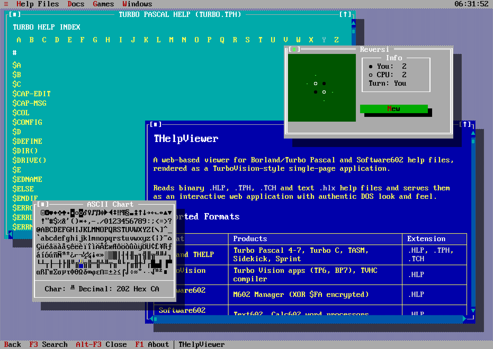

# THelpViewer




A web-based viewer for legacy DOS help files, rendered as a TurboVision-style
single-page application.

Homepage: [https://thelp.zdrojak.dev](https://thelp.zdrojak.dev)

Reads multiple legacy DOS help formats including Borland THELP, Microsoft
QuickHelp / BW03, Borland TDH/TFH runtime help, Norton Guide, FBHF,
Software602, and text `.hlx` / `.hl6` sources, then serves them as an
interactive web application with authentic DOS look and feel.

## Supported Formats

| Format | Products | Extension |
|--------|----------|-----------|
| **Borland THELP** | Turbo Pascal 4–7, Turbo C, TASM, Sidekick, Sprint | `.HLP`, `.TPH`, `.TCH`, `*.T?H` with THELP signature |
| **Borland TDH/TFH runtime help** | Turbo Debugger 1.0/2.x, Turbo Profiler | `.TDH`, `.TFH` |
| **Microsoft BW03** | Older CodeView DOS / OS2 help (`CV.HLP`, `CVP.HLP`) | `.HLP` |
| **Microsoft QuickHelp (LN)** | QuickBASIC, QuickC, MASM 6, PWB, LINK | `.HLP` |
| **HelpPC 2.10** | Six linked DOS text databases | `.TXT` |
| **FreeDOS HTML Help** | HHSTNDRD HTML page collection | `HHSTNDRD.ZIP` |
| **Norton Guide** | Norton Guides and Expert Help databases | `.NG` |
| **TurboVision FBHF** | Turbo Vision apps (TP6, BP7), TVHC compiler | `.HLP` |
| **Software602 M602** | M602 Manager (XOR $FA encrypted) | `.HLP` |
| **Software602 Text602** | Text602, Calc602 word processors | `.HLP` |
| **HLX/HL6 text** | Decompiled text format (round-trip capable) | `.hlx`, `.hl6` |
| **Scorpion's Cheater legacy / DAT (experimental)** | Scorpion's Cheater 1-23 (`legacy` 1-14, modern DAT 15-23) | `.exe`, `.dat`, `.sco`, `.scd`, `.scx` |
| **Game-Cheater Pc-Fand** | Game-Cheater 9.02 cheat, company, URL, help and database tables | paired `.000`, `.T00` files |

Borland TDH/TFH runtime help is decoded for the current known TDH 1.0, later
TDH 2.x, and TFH sample families.

## Quick Start

### Local

```bash
# 1. Download help files from the internet (requires unar)
./thelp.sh download

# 2. Build UHF 2.0 `.json.gz` bundles from source help files
./thelp.sh build

# Optional: rebuild only the help catalog from already generated bundles
./thelp.sh catalog

# 3. Serve locally through FastAPI
./thelp.sh serve start
```

To include the four locally downloaded DOS reference products, use
`./thelp.sh build --with-dos-reference` in place of the regular build command.

Useful local server commands:

```bash
./thelp.sh serve status
./thelp.sh serve restart
./thelp.sh serve stop
```

Or do everything at once (download + build + Docker start):

```bash
./thelp.sh all
```

Open http://localhost:5448 in your browser.
Port 5448 = `0x5448` = ASCII "TH" (THelp).

### Docker

```bash
./thelp.sh all
```

That downloads missing source archives, builds `data/helps/`, and starts the
FastAPI server in Docker on http://localhost:5448.
Python bytecode caching remains enabled, with `PYTHONPYCACHEPREFIX` pointing to
`/tmp/thelp-python-cache` inside the container instead of the source tree.
It is reused on container restart and regenerated on container recreation.

If bundles already exist, plain Docker startup is enough:

```bash
./thelp.sh docker start
```

Useful Docker commands:

```bash
./thelp.sh docker stop
./thelp.sh docker restart
```

The container image installs Python dependencies and 7-Zip for disk-image
extraction, and
docker-compose bind-mounts the whole repository into `/app`, so JS/CSS/docs/help
data are never copied into the image. Docker startup reads HELP files at their
original paths before mounting the repository. On macOS this also downloads
files that have been offloaded to cloud storage, so Docker can read them through
the bind mount. No second copy is created. If macOS offloads them again later,
use `./thelp.sh docker start` to make them locally available again.

### DOS Prompt

Open **≡ → DOS Prompt** for a real WASM DOSBox inside a standard `TVWindow`.
Its contextual top menu provides Pause/Resume, Restart, Save C to cloud,
Mount CD/Floppy, Eject and Fullscreen. Ctrl+Alt+M returns keyboard focus to
that menu. The emulator pauses when its window is inactive or the tab is hidden.
Fullscreen displays only DOS without the TVision frame/menu or browser chrome;
Esc returns to the window, while Ctrl+Alt+M also opens its control menu.

After an administrator confirms selected packages, the server prepares `var/dos/c/` from
[`thelpviewer/dos-prompt.json`](thelpviewer/dos-prompt.json). The default source
includes FreeDOS EDIT, Volkov Commander and DOS games. Run `EDIT`, `VC` or
`TYPE C:\SOFTWARE.TXT` for game launch commands. Initialization shows a shared
progress dialog. Additional trusted
software sources use HTTPS, an allowed-host list,
a required SHA-256 and ZIP or IMG extraction. `THELP_DOS_CONFIG_PATH` can select
another manifest. The shared disk is created only once: later restarts do not
reinstall software or change the disk from an edited source list. Runtime
memory/cycles changes still take effect after restarting the server. Use
`python -m thelpviewer.tools.install_dos_sources` to explicitly add configured
software to an existing disk, then restart the server.

Sign in through the existing Passkey dialog to keep a private C-drive overlay
on the server as regular files with SQLite deletion/revision metadata.
Only files DOS actually reads are downloaded, in gzip-capable 64 KiB chunks;
workers are required by default, with no automatic full-disk fallback.
Admins can configure the default 64 MiB private-only quota through
**User name → Configuration → Server Configuration**. Changes never modify the shared base. Saves run every minute
while active, and before closing or restarting DOS. Before closing the browser
tab, explicitly choose **Save C to cloud**: a tab close/crash cannot guarantee
a final upload. Guests can try DOS but cannot save or mount private media.
This stores files (configuration and savegames), not a running CPU/RAM snapshot.

Mounting/ejecting media restarts DOS after confirmation. The first version
supports one image at a time, ISO9660 CD images up to 128 MiB and raw floppy
images up to 16 MiB; writes inside a floppy image are temporary. DOSBox's native
secure mode blocks interactive MOUNT/IMGMOUNT/BOOT commands; the browser does
not execute these as host/server commands. See
[DOS Prompt](docs/THelp%20Viewer/DOS%20Prompt.md) for storage, APIs and limits.

### Game MIDI library

On server startup, the MIDI downloader indexes the HTML pages configured in
[`thelpviewer/midi-sources.json`](thelpviewer/midi-sources.json) and downloads
missing MIDI tracks in the background into `var/midi/`. It resumes after a
restart without fetching existing valid tracks again. The player reads the
SQLite catalog at `var/midi/library.sqlite3` through `/api/midi/catalog` and
plays local files through `/api/midi/files/...`; the previous bundled demo
tracks are no longer its playlist. ZIP sources are unpacked selectively: only
valid `.mid`/`.midi` tracks and a configured cover image are retained.
SQLite stores one `midi_tracks` row per playable file, with game/title/source
metadata and its optional `midi_covers` image reference; `midi_index` retains
the original source links needed to resume ZIP downloads.
The catalog total counts individual MIDI files inside those ZIPs, not distinct
games or unique compositions; separate entries can contain identical MIDI data.
The player lists both ready and pending items. A cloud marks a pending item;
pressing Play or activating its row queues that source link ahead of the
background order and starts playback when it arrives. The cloud icon is at the
far right of each row. If the catalog API is temporarily unavailable, an open
player retries it automatically every three seconds. Clicking the playback
gauge seeks within
the playing track. Source-provided covers appear in the player when available.
FluidSynth and the bundled FluidR3Mono General MIDI SoundFont reproduce the
file's instruments and percussion. The player starts fetching the SoundFont
when opened so the first Play click does not initiate that large download.
Pause preserves the current position and
Play resumes it; the transport buttons have a one-character gap. Playback
continues with the next track when
one ends; the Random next track checkbox under More switches to shuffle mode.
The Download progress dialog uses the shared Turbo Vision gauges and can be hidden without stopping
the server download; the Downloads button reopens it. More expands the playlist
and its Filter input, which matches game, track title, or sequencer. The old
free-form MIDI URL input and external Commons/ToBeFree presets are removed.
The Filter's history arrow reuses the standard Turbo Vision history popup;
press Enter, start a track, or close the player to remember the current filter.

Each JSON source declares `pages` as a nonempty list of HTTPS URLs,
plus `allowed_hosts`, an `extract` rule, and an optional `cover` rule. A
single-page source retains its configured ID. For multiple pages, each page is
indexed as a separate resumable source; its suffix is derived from the URL
path/query after the common path stem. This keeps Karl's existing `-d` ID and
already downloaded tracks. Supported extraction modes are
`table_rows` (game-header table with MIDI links), `anchors` (simple link list),
`download_then_heading` (ZIP Download link followed by a game heading), and
`selectors` (one block per track, with CSS selectors for its fields). For
`selectors`, set `item_selector` and optionally `link_selector`,
`game_selector`, `title_selector`, `sequencer_selector`, and field-specific
`*_attr` when the value comes from an HTML attribute.
The optional `href_pattern` filters link URLs; it does not parse the entire
HTML page. Omit extraction fields that match the parser defaults. A single
regex over HTML is deliberately not used because nesting and attribute order
can change. Row class/cell numbers, heading tag/prefix and download link text
are source-specific JSON settings when needed. An optional
`THELP_MIDI_SOURCES_PATH` points to another source JSON file; add or edit a
source and restart the server. `/api/midi/catalog` reports download progress
and any errors. Karl's available numbered and lettered DOS pages are enabled;
VGMusic is retained in the manifest with `"enabled": false` and is not shown
or downloaded. Karl's ZIP cover images populate the MIDI Player's `TVImage`
when present. The JSON rules
cover these four HTML layouts; unusual sites may
still need a new mode. Automatic external cover search is not
enabled: source-provided images are used only when they can be associated with
the downloaded game, avoiding incorrect matches to similarly named releases.

These source sites contain game compositions and arrangements that may still
be copyrighted. Source URLs, game names and sequencer attribution are retained
in SQLite. Before using the automatic downloader on a public deployment,
review the source's terms and your rights to redistribute its MIDI and art.

## Project Structure

```
THelpViewer/
├── www/                    ← Static frontend shell served by FastAPI
│   ├── index.html          ←   SPA entry document
│   └── assets/             ←   JS, CSS, fonts, images
├── thelpviewer/            ← Unified Python package root
│   ├── converter/          ←   help converter package
│   │   ├── readers/        ←     format readers (thelp, tdh, bw03, quickhelp, ng, fbhf, hlx, m602, scorpion)
│   │   ├── writers/        ←     output writers (html, uhf json, bundle, md)
│   │   ├── base.py         ←     shared data model (HelpDocument, TopicRecord, …)
│   │   ├── codepages.py    ←     encoding tables (CP437, CP852, Kamenický)
│   │   └── exporter.py     ←     high-level export orchestration
│   ├── downloader/         ←   help file downloader
│   │   ├── catalog.py      ←     typed facade over help-database.json
│   │   ├── http.py         ←     shared HTTP + HTML helpers
│   │   ├── extractor.py    ←     recursive unar/lsar extraction
│   │   └── *.py            ←     one provider per website
│   ├── help_database.py    ←   shared manifest loader and validation
│   ├── server/             ←   FastAPI app
│   │   ├── app.py          ←     app setup, shared services and static mounts
│   │   ├── config.py       ←     env-based runtime configuration
│   │   ├── accounts.py     ←     Passkey accounts, tokens and sessions
│   │   ├── statistics.py   ←     aggregate counters and Hall of Fame storage
│   │   ├── search_index.py ←     global HELP and Docs search index
│   │   ├── routes/         ←     HTTP endpoints grouped by responsibility
│   │   │   ├── auth.py     ←       login, registration and tokens
│   │   │   ├── public_pages.py ← crawlable pages and sitemaps
│   │   │   └── statistics.py ← statistics and Hall of Fame API
│   │   └── __init__.py
│   └── help-database.json  ←   products, download sources, build groups, conversion files, CRC metadata
├── downloads/              ← Legacy local downloader cache (not moved automatically)
├── data/                   ← Permanent data (included in backups, excluded from Git)
│   ├── sources/<Product>/  ← Original HELP files and licence notices
│   ├── helps/<Product>/    ← Published UHF bundles + catalog.json
│   ├── docs/               ← Published documentation / permanent additional documents
│   ├── dos/users/<id>/     ← Private overlays, savegames and removable media
│   ├── accounts.sqlite3    ← Accounts, Passkeys and sessions
│   ├── statistics.sqlite3  ← Statistics and Hall of Fame
│   └── content-settings.json ← Administrator's selected HELP / DOS packages
├── var/                    ← Rebuildable runtime data; do not erase wholesale
│   ├── downloads/help/     ← Cached HELP downloads / archives
│   ├── downloads/dos/      ← Cached DOS package archives
│   ├── dos/c/              ← Generated shared C disk
│   └── midi/               ← Downloaded MIDI tracks, covers and catalog
├── docs/                   ← Version-controlled documentation sources
│   ├── Formats.md          ←   binary format index
│   ├── Formats/            ←   detailed format specifications
│   │   ├── Borland THELP.md
│   │   ├── Borland TDH.md
│   │   ├── TurboVision FBHF.md
│   │   ├── Software602.md
│   │   ├── Software602 M602.md
│   │   ├── Software602 Text602.md
│   │   └── Help Source Text Format.md
│   └── THelp Viewer/       ←   viewer and tool docs
│       ├── Bundle.md       ←   JSON bundle transport format
│       ├── Converter.md    ←   converter usage & architecture
│       ├── Downloader.md   ←   help file downloader
│       └── TurboVision JS.md ← JS UI framework API
├── thelp.sh                ← Build, serve & manage script
├── Dockerfile
├── docker-compose.yml
└── tools/
    ├── rebuild_help_database.py ← Rebuild the canonical help database from sources
    └── rebuild_catalog.py       ← Rebuild helps/catalog.json from existing bundles
```

## Features

- **Authentic TurboVision UI** — menus, windows, scrollbars, dialogs, resize, maximize
- **Compressed structured bundles** — UHF 2.0 payload stored as `.json.gz`
- **Loading progress** — DOS Navigator-style dialog with progress bar and Cancel
- **Server statistics** — privacy-preserving aggregate SQLite counters shown in a Turbo Vision window
- **System information** — local application, browser, display, locale, storage and capability details with live server/catalog status
- **Grid Viewer** — two-dimensional Turbo Vision list with visible column headers and two-axis scrolling
- **Users** — administrators manage profiles, roles, enabled accounts and individual private C capacities
- **Shared Hall of Fame** — server-wide top-ten tables with automatic local-browser fallback
- **Full-text search** — search the active window or all public HELP files and Docs through a server-side index
- **A–Z index navigation** — letter jump links in the index view
- **Window management** — zoom (F5), close (Alt-F3), drag, resize
- **Theme support** — light, dark, auto (system preference)
- **Color customization** — TurboVision Colors dialog with live preview
- **Syntax highlighting** — Pascal, C, and ASM highlighting (client-side)
- **Code block heuristic** — automatic detection for older formats without markers (TC 2.0/2.01)
- **Built-in apps** — Calculator, ASCII table, Calendar, Tetris, Minesweeper, Puzzle

## Bundle Size

Measured on the current generated UHF 2.0 payloads:

| Source | Original help | Raw UHF JSON | Compressed `.json.gz` | Reduction (orig→gz) | Reduction (UHF→gz) |
|--------|---------------:|--------------:|----------------------:|-------------------:|-------------------:|
| `Borland Pascal 4.0/TURBO.HLP` | 85,344 B | 326,369 B | 47,130 B | 44.7% | 85.6% |
| `Microsoft QuickBASIC Extended 7.1/BAS7QCK.HLP` | 230,419 B | 858,630 B | 115,323 B | 50.0% | 86.6% |
| `Norton Guides/DOS.NG` | 58,664 B | 125,313 B | 22,072 B | 62.4% | 82.4% |
| `Borland C++ 3.1/TCHELP.TCH` | 1,544,843 B | 4,513,532 B | 626,963 B | 59.4% | 86.1% |

## How It Works

1. The **downloader** (`python3 -m thelpviewer.downloader`) reads one shared manifest of
   logical products and fetches them via provider-specific downloaders
   (WinWorldPC, archive.org, old-dos.ru, GitHub, DaveP NG mirror, Cheater.cz) into `data/sources/`
   When called without selectors it downloads everything it knows about and skips
   files already present in `var/downloads/help/` or `data/sources/`

The downloader now also manages the full published DOS Scorpions Cheater corpus.
Those releases are stored under `data/sources/Scorpions Cheater DOS/` in per-version
subdirectories so DAT-era and pre-DAT-era builds can coexist without overwriting
each other.
2. `thelp.sh build` runs the converter over manifest-backed build groups resolved
   from `thelpviewer/help-database.json`. The default build still covers
   `borland`, `microsoft`, `norton-guides`, and `software602`, while the
   Scorpions Cheater group remains opt-in and can be generated later with
   `./thelp.sh build group=scorpion`. The same grouped build path also works for
   other families such as `group=borland`, `group=microsoft`,
   `group=norton-guides`, or `group=all`. The `dos-reference` group is opt-in;
   `./thelp.sh build --with-dos-reference` builds it together with the default
   groups, retains unrelated opt-in bundles, and adds eleven DOS reference
   bundles from four products to the local Help Files catalog.
   Review their redistribution terms before publishing the generated files.
3. Each help file is parsed and rendered into a UHF 2.0 JSON payload containing
   structured topics, index entries, and metadata
4. The JSON payload is gzip-compressed into a `.json.gz` bundle for web transport
5. A `catalog.json` is generated in `data/helps/`
6. FastAPI serves `www/`, `data/helps/`, and published `data/docs/` directly
7. The browser fetches `.json.gz` bundles on demand, decompresses them, and renders them in a TurboVision window

The canonical [help-database.json](thelpviewer/help-database.json) is shared by
the downloader and converter. Schema version 2 contains downloader providers,
converter handlers, product families, build groups, conversion file rules,
output bundle groups, and the existing source metadata keyed by `crc32`. Product families group
multiple releases without duplicating provider configuration. CRC entries are
assigned to a family through `collection_prefixes` and expose the remaining
collection suffix as the release version.

Encoding resolution uses this precedence: explicit parameter, CRC database
entry, then payload autodetection. Bundle export also uses the database for
CRC-based deduplication; files without CRC metadata keep their directory-based
grouping.

See [Bundle format](docs/THelp%20Viewer/Bundle.md) for the JSON bundle specification.

To build and serve in one step:

```bash
./thelp.sh build serve start
```

To serve only (if bundles are already built):

```bash
./thelp.sh serve start
```

After regeneration, restart the local server or Docker and hard-refresh the browser (Ctrl+F5).

Deploy the viewer's JS/CSS assets together with `www/index.html`, not only the
files modified since the last local commit: the target may run an older release.
Keep its asset-version URLs in sync with the bundle writer so browser caches do
not mix releases. Do not overwrite `.env`, `data/`, runtime `var/` or migrated HELP/MIDI data.

### Server statistics and errors

The System menu's **System Information** dialog reports the current application
version, page mode, browser/OS, display and Turbo Vision cell geometry, locale,
storage availability and browser capabilities. Its Server category checks the
running version and HELP/Docs catalog sizes. These details remain local to the
dialog and are not submitted as statistics merely by opening it.

The System menu's **Statistics** window reads aggregate counters from
`data/statistics.sqlite3`. The location can be changed with
`THELP_STATISTICS_PATH`; `THELP_DATA_DIR` changes permanent storage.
`app.py` creates the store; `server/routes/statistics.py` registers the statistics
and Hall of Fame endpoints without changing their URLs or response formats.
SQLite uses its rollback journal so the database also works when `data/` is a
Docker Desktop bind mount.
The server records daily visits, referrer hosts, proxy-supplied country codes,
screen/viewport sizes, pixel ratio, color depth, coarse device/OS/browser
families, language, time zone, theme and orientation/pointer/accessibility
preferences. Usage counters cover HELP/Docs/topic and dialog opens, searches
as found/no-results without the entered text, internal/external/broken links,
game outcomes with duration intervals and coarse client-error categories.
MIDI statistics aggregate completed/ended plays and actually played minutes
per track and day; paused time is excluded. The Statistics dialog shows the
total and top tracks under MIDI playback. No listener identity is stored.
The viewer also measures active time for each HELP file, Markdown document,
dialog and game: switching to another window or hiding the browser tab pauses
that target, and returning resumes it.
Performance counters group TTFB, page load, LCP, CLS, INP and HELP
download/decompression/render times into intervals. Active visit time is also
stored only as an interval. The server deliberately does not store IP
addresses, cookies, persistent visitor identifiers, full referrer URLs, raw
user-agent strings, search text, individual playback intervals or individual visit rows. HELP
statistics show the catalog's long display name rather than its source
filename.

Game scores use `GET/POST /api/hall-of-fame/{game}` and are shared by all
visitors of the server. A public score consists only of the entered player
name, score and short game note; Sokoban also stores the level reached and
ranks it before the move count. When the API is unavailable (for example when
the generated viewer runs directly from disk), the existing per-browser
`localStorage` Hall of Fame remains active; local entries are not uploaded
automatically.

Unknown browser URLs are redirected into the application and shown through a
Turbo Vision error MessageBox. `/api/...` callers continue to receive JSON HTTP
errors.

### Global HELP and Docs search

The server builds `var/global-search.sqlite3` automatically on first start.
It indexes the existing `.json.gz` HELP bundles and public Markdown Docs in
place, updating changed or removed files when the catalog is checked again.
Private RE/audit documents stay excluded; virtual aliases to the same README
or CHANGELOG are indexed only once. Search
Topics and Find each have two exclusive radio choices: server-wide search when
the API is available, and local search when an eligible HELP/Docs window is
open. Search Topics shows the source filename on each result's second line and
opens Docs results in the existing TVision document window. `GET /api/search/status`
reports index progress and `GET /api/search/global?q=...` returns ranked HELP
topics and Docs. If a global
search is opened during indexing, a Turbo Vision dialog shows the percentage;
Hide closes the dialog without stopping the server job. Generated pages opened
without the server retain local search but cannot use the global API.

### Search-engine pages

`thelpviewer/server/app.py` assembles the FastAPI app and shared services.
`thelpviewer/server/routes/public_pages.py` supplies the public-page `APIRouter` for
viewer previews, `robots.txt` and sitemaps; the full-text index itself remains
in `search_index.py`. These are separate from the JSON global-search API.

Indexing isolates HELP/Docs file errors: the original file is never removed,
only its invalid cached rows. Healthy files remain searchable and appear in
sitemaps. `/api/search/status` and search responses report `warnings` with the
source kind, relative filename and error, and the server logs the failure.
An unchanged failed source is not retried on every request; changing its
content/permissions (size, mtime or ctime) or restarting the server retries it.
Removed sources clear their warnings, and successful retries restore their
topics/Docs automatically. Global database errors are still fatal, not hidden
as per-file warnings.

The status `available` flag is separate from indexing progress. Readers use
completed per-file transactions during background updates, while `state`
remains `building`. With no usable initial index, search returns 202 and public
content/sitemaps return 503 with `Retry-After`; a known unreadable individual
file also returns 503 while healthy pages return 200. Search/progress dialogs
show the count of skipped files. No original HELP bundle or link is rewritten.

The server-rendered homepage links to each public HELP-file overview and Doc;
the TVision interface replaces that catalog after loading, but its Help Files
and Docs menu entries retain real `<a href>` URLs to the same pages. HELP
indexes, Contents trees and topic links similarly expose `?file=...&topic=...`
addresses after rendering. Ordinary clicks still dispatch `TVEvent` commands
and open the existing viewer windows without a page reload; browser-modified
clicks use the real link destination. Local aliases resolve to the actual topic
ID, and cross-file links use the existing source-file/catalog resolver. If an
external alias cannot be resolved before its bundle is loaded, its browser
fallback points to that HELP file's overview; TVEvent retains the original
target. No extra HTML landing page is introduced. The sitemap index also
includes `/sitemaps/site.xml` for the homepage.

The server exposes an overview of each HELP file at `/?file=<bundle-path>`
with links to its non-empty topics. Each topic is server-rendered at
`/?file=<bundle-path>&topic=<context>`. The page starts the
interactive TVision viewer and opens that HELP file/topic directly; its initial
HTML also contains the topic text for crawlers. `/robots.txt` points to
`/sitemap.xml`, which lists a separate
`/sitemaps/file.xml?file=...&page=...` sitemap for each HELP file. Those maps
contain its overview and topic URLs; a large file is split into multiple maps.
Public Docs use `/?doc=<path>`: opening the link starts the TVision document
window directly, while the server-rendered HTML contains the same document
text for crawlers. They have their own `/sitemaps/docs.xml` entry. The raw
`/docs/<path>` Markdown endpoint remains available to the TVision viewer.
The older numbered topic sitemaps remain available but are not listed in the
main sitemap index. This lets crawlers discover content without executing the
viewer JavaScript or understanding `#tv=...` fragments. Set
`THELP_PUBLIC_BASE_URL=https://thelp.zdrojak.dev` on the public deployment so
canonical and sitemap URLs use the HTTPS hostname. A sitemap advertises pages;
it does not guarantee indexing by search engines.

In Google Search Console, submit `sitemap.xml` under the
`https://thelp.zdrojak.dev/` property and check its fetch/processing status.
Requesting indexing of `/` alone does not submit the sitemap or request every
HELP topic. Google may need days or weeks to crawl and select individual pages.

Equivalent HELP/Docs query URLs permanently redirect (HTTP 308) to the same
encoding and parameter order used in the sitemap: spaces as `+`, literal plus
signs as `%2B`, and path separators as `%2F`. Viewer options such as `line`
and browser fragments are preserved; the canonical excludes these options.
Missing resources still return 404 rather than being repaired heuristically.
The browser error-page destination (`?server_error=404&server_path=...`) also
returns HTTP 404 and `X-Robots-Tag: noindex`, while retaining the TVision
MessageBox. It must not masquerade as an indexable 200 homepage.

Original HELP files also document messages such as "Match Not Found" or
"Could not find file". Public topic previews explicitly identify their text
as original reference documentation, not a live website error. These useful
diagnostic topics stay indexable. The same rules apply to every non-empty
topic, including short or placeholder-like messages: the server does not
classify their meaning by filename, topic ID, language, text or text length.
Only empty topic bodies are omitted from topic sitemaps and return 404 on
public topic URLs. Original bundles, topic IDs and links are unchanged.

`docker-compose.yml` already passes `THELP_PUBLIC_BASE_URL` through. On the
public host, put `THELP_PUBLIC_BASE_URL=https://thelp.zdrojak.dev` in a `.env`
file beside `docker-compose.yml`, then run `docker compose up -d --force-recreate viewer`.
Leave it unset locally so local sitemap links point to localhost. The `.env`
file is ignored by Git. A plain `docker compose restart` does not apply changed
environment variables.

For Google Search Console meta-tag verification, set
`THELP_GOOGLE_SITE_VERIFICATION=<content value from Google>` in that same
`.env` file and recreate the viewer container. Enter only the `content` value,
not the whole `<meta>` element. The server inserts the tag into the home page
and public HELP/Docs pages. If the variable is unset, it emits no verification
tag; exported standalone HTML never contains a deployment-specific token.

### Admin-created Passkey accounts

On first startup with an empty accounts database, the server prints a one-hour
bootstrap token in the Docker logs. Find it with
`docker compose logs viewer | grep 'first administrator registration token' | tail -n 1`;
`docker compose logs --tail` may omit the startup line after later requests.
If an account already exists, no bootstrap token is printed. In Login → Register, enter
your name, email and token to create the first administrator Passkey. Signed-in
admins gain User name → Registration Token to issue one-hour, single-use tokens
for other users, review still-valid tokens and revoke selected tokens. The
Login appears on the right of the menu bar. After sign-in it becomes the user's
display name with Account, Configuration and Sign Out. Colors currently
remain browser-local; server configuration and tokens are admin-only.
Account opens profile settings (display name, email and read-only role), not
the Login dialog. Save updates only the signed-in user's profile and menu name.
The stable username/account ID, Passkeys, sessions and private DOS files remain
unchanged. Both the updated email and original username can be used to sign in;
email addresses are not verified mailboxes. Users cannot edit their role here.
The local origin defaults to `http://localhost:5448`. On the public host, set
`THELP_AUTH_ORIGIN=https://thelp.zdrojak.dev` in the same `.env` file as
`THELP_PUBLIC_BASE_URL`; the latter only configures public links and does not
enable Passkey login. Recreate the container with
`docker compose up -d --force-recreate viewer` (a restart does not reload
environment variables), then check that `/api/auth/session` returns
`"enabled": true`. Do this only after securing the Cloudflare-to-origin
connection. See [Accounts](docs/THelp%20Viewer/Accounts.md) for setup and the
current security limitations. Server Terminal and its ID/key API have been removed.

For local VS Code testing without Passkey support, use
`docker compose -f docker-compose.yml -f docker-compose.local.yml up -d --build --force-recreate viewer`.
This opt-in mode binds only `127.0.0.1`, signs in as Admin and
uses separate development accounts/sessions. Never expose it publicly. Normal
`docker-compose.yml` keeps Passkey authentication enabled and auto-login off;
see [Accounts](docs/THelp%20Viewer/Accounts.md#local-development-without-passkeys).

Signed-in administrators have User name → Configuration → **Rebuild DOS C**
and **Rebuild MIDI** in production as well as local development, with confirmation
and a shared progress dialog. The API requires an active administrator session,
the configured host and an exact same-origin write; ordinary members are denied.
Previous data moves to `var/backups/` for recovery:
DOS rebuild retains private overlays/source archives; MIDI rebuild stops the
existing downloader before replacing tracks, covers and catalog and downloading
the configured sources again. Keep backups deliberately; repeated rebuilds use
disk space. The built-in Help Contents/Index documents these tools and accounts.

Passkey registration also requires the `webauthn` Python package in the Docker
image. After updating the project or `requirements.txt`, use
`docker compose up -d --build --force-recreate viewer` on the server (or
`./thelp.sh docker start`); recreating without `--build` retains old installed
packages. If the package is missing, Passkey endpoints return JSON HTTP 503.

## Documentation

### Format Specifications

- [Format index](docs/FORMATS.md) — overview and comparison of all binary formats
- [Borland THELP](docs/Formats/Borland%20THELP.md) — TP4–7, Turbo C, TASM, Sidekick, Sprint
- [Borland TDH/TFH runtime help](docs/Formats/Borland%20TDH.md) — Turbo Debugger 1.0/2.x, Turbo Profiler
- [TurboVision FBHF](docs/Formats/TurboVision%20FBHF.md) — TP6, BP7 THelpFile (TVHC compiler)
- [Software602](docs/Formats/Software602.md) — M602, Text602, Calc602 help families
- [Help source text format](docs/Formats/Help%20Source%20Text%20Format.md) — HLX/TXT decompiled-source specification
- [HelpPC 2.10](docs/Formats/HelpPC%202.10.md) — keyed DOS text databases
- [FreeDOS HTML Help](docs/Formats/FreeDOS%20HTML%20Help.md) — HHSTNDRD HTML archive

### Viewer & Tools

- [Converter](docs/THelp%20Viewer/Converter.md) — help file converter (binary → HTML / JSON / Markdown)
- [JSON Bundle format](docs/THelp%20Viewer/Bundle.md) — transport format for the SPA viewer
- [Downloader](docs/THelp%20Viewer/Downloader.md) — automated help file downloader
- [TurboVision JS](docs/THelp%20Viewer/TurboVision%20JS.md) — JavaScript UI framework API reference

The FastAPI docs catalog also exposes `README.md` and `CHANGELOG.md`
virtually under `docs/THelp Viewer/`, so they appear in the viewer without
duplicating files on disk.

## Requirements

- Python 3.10+
- `fastapi` and `uvicorn` for local serving (`pip install -r requirements.txt`)
- Modern browser with DecompressionStream API support
- Docker (optional, for containerized deployment)

## License

This project is licensed under the [GNU General Public License v3.0](LICENSE).

### Bundled Fonts

The bitmap fonts in `www/assets/fonts/` are from
[The Ultimate Oldschool PC Font Pack](https://int10h.org/oldschool-pc-fonts/)
by VileR, licensed under [CC BY-SA 4.0](www/assets/fonts/LICENSE.TXT).
